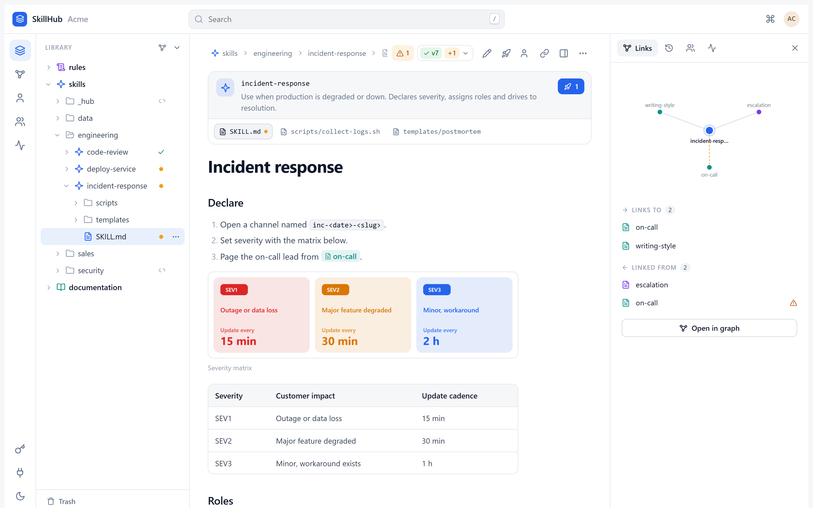
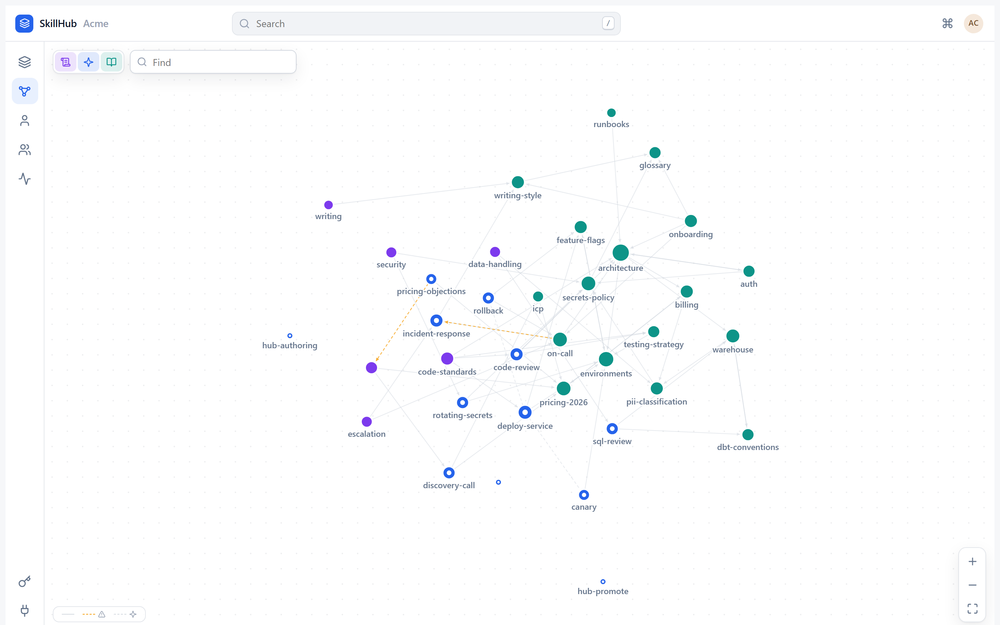
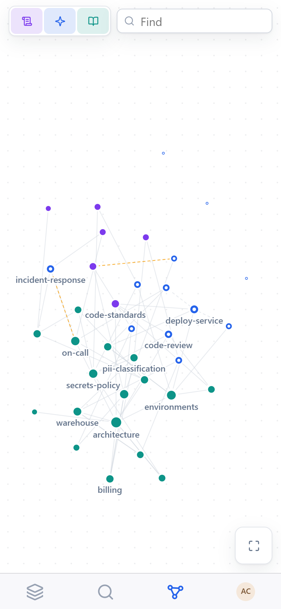
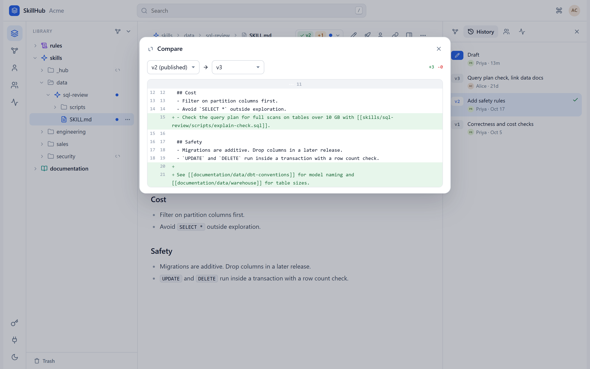
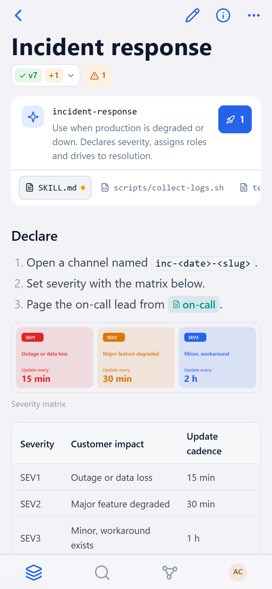
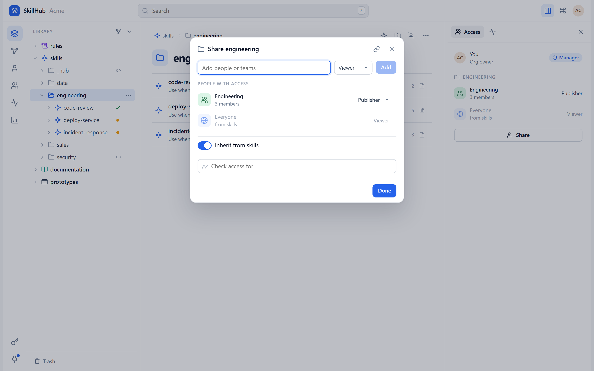
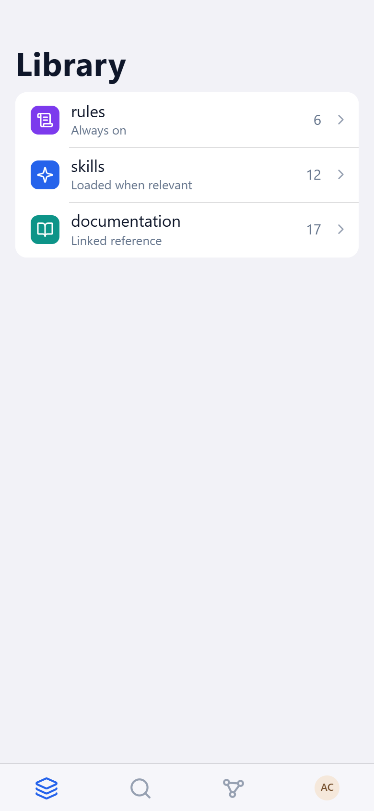

# SkillHub

One shot project to let a small org store, version and share AI configuration files and manage access control.

<p>
  
</p>

## The idea

Agents get better when they share what a team already knows: how we review code, how we run incidents, what never to do in production. Today that lives in scattered `CLAUDE.md` files, pasted prompts and wiki pages nobody versions. SkillHub keeps it in one place, with the same discipline as code (drafts, versions, publish, rollback, audit) and the same access model as a shared drive. Every agent your people use connects to it over MCP and gets exactly what that person may read.

The library has four areas, each with its own nature:

| Area | What it is | How agents get it |
| --- | --- | --- |
| `rules/` | Short files, always on | Sent as the MCP instructions on connect, capped at 8 KB |
| `skills/` | One folder per skill: `SKILL.md`, templates, scripts, sub-skills | Found and loaded when relevant |
| `documentation/` | Free-form reference pages | Followed through links |
| `prototypes/` | One folder per prototype: `index.html` plus its CSS, JS and notes | Opened through a signed preview link, or screenshotted |

They connect through canonical `[[area/path]]` links: rules point to skills and docs, skills to docs and prototypes, docs to each other and to prototypes. That makes the whole library a graph.

<table>
  <tr>
    <td width="66%"></td>
    <td width="34%"></td>
  </tr>
</table>

## Features

- **Versions and publishing.** One shared draft per document, immutable versions, a publish pointer. Viewers and most agents only ever see what was published. Rollback is publishing an older version. A whole skill folder publishes in one step.
- **History and diffs.** Every version is kept and diffable before you publish it.
- **Access control.** Viewer, Editor, Publisher and Manager on folders, inherited down the tree, with boundaries that stop inheritance. Teams.
- **Sign-in your way.** Microsoft Entra ID, Google Workspace, your own OpenID Connect server, or email links with passkeys, in any combination. Invite people from outside by email: they join as external users with exactly the access you gave them.
- **One MCP endpoint.** Claude, ChatGPT and Copilot connect with OAuth, a consent page and scope checkboxes. Tools are filtered by scope and role.
- **Links, backlinks and a graph.** A link to something you cannot read shows as locked and is never named.
- **Prototypes.** Clickable HTML mockups, versioned and published like everything else, shown live in the app at desktop, tablet and phone width. Agents get a signed preview link to open in their own browser, or a screenshot with console errors (`render_prototype`) when they have none. Prototype scripts run sandboxed, never with the viewer's session.
- **Authoring warnings.** Small, dismissable hints when a skill or rule breaks the usual guidelines (vague names, descriptions that do not say when to use them, long rules, broken links). They come back from the MCP write tools too, so agents fix their own drafts.
- **Audit.** Every call, including which agent read which skill version. Seven days in the database, then archived to R2.
- **Usage.** Which skills and docs agents actually load, by whom, and what they never find: loads, times shown in search results, a daily chart and notes like *Never found* or *No links in*. Owners only, informative only, 90 days. The graph can size nodes by use.
- **Setup guide.** Connections opens with per-client steps for Claude, ChatGPT and Copilot Studio and a prompt to try. Dismiss it; the Setup guide button brings it back.
- **REST, MCP and a typed client from one registry.** Every operation is defined once.
- **Desktop and phone.** The phone layout follows iOS conventions: tab bar, push navigation, sheets, swipe actions.
- **Cheap to run.** One Cloudflare Worker with D1, R2 and KV, on the $5 Workers plan. Or self-hosted: one Docker image with SQLite or Postgres, files on disk or in any S3-compatible bucket.

<table>
  <tr>
    <td width="66%"></td>
    <td width="34%"></td>
  </tr>
  <tr>
    <td width="66%"></td>
    <td width="34%"></td>
  </tr>
</table>

## Ideas

Not built, and not planned. Things that would fit on top:

- **Marketplace.** Let a company sell access to its skills to other organizations.
- **MCP gateway.** Put the org's other MCP servers behind the same sign-in, scopes and audit.
- **Ingestion.** Turn email, Slack and Teams threads into documentation pages that link back to their raw sources.
- **Semantic search.** A distillation and embeddings layer for search and for picking the right skill.
- **Sleep-style jobs.** Background passes that flag inconsistencies and contradictions, surface connections, and propose updates to stale pages.

## Deploy

[](https://deploy.workers.cloudflare.com/?url=https://github.com/DorsazWilliam/skillhub)

The button forks the repository and creates the database, bucket and cache for you. You still need the Entra app registration and secrets; `npm run setup` below does all of it from your machine.

### Self-hosted

One Docker image runs anywhere: `docker run`, Docker Compose (alone, with bundled Postgres and S3 storage, or against yours) or Kubernetes with the Helm chart in `deploy/helm`. SQLite on a volume, or Postgres and any S3-compatible bucket. See [docs/SELF_HOSTING.md](docs/SELF_HOSTING.md).

### From your machine

Prerequisites: Node 22+, a Cloudflare account on the Workers Paid plan, a zone on that account for the hostname, and an Entra app registration ([docs/ENTRA.md](docs/ENTRA.md)).

```powershell
git clone https://github.com/DorsazWilliam/skillhub
```

```powershell
cd skillhub; npm ci
```

```powershell
npm run setup
```

Setup prints two URLs: the Entra redirect URI to paste into the app registration, and the MCP connector URL to paste into Claude, ChatGPT or Copilot Studio ([docs/CLIENTS.md](docs/CLIENTS.md)). Sign in with an `OWNER_EMAILS` address first; that account becomes owner.

## Pricing

Needs the Workers Paid plan at $5 per month. The free plan's 10 ms CPU limit and daily D1 caps are not suitable. Paid includes 25 billion D1 rows read and 50 million rows written per month, 10 GB of R2 and 10 browser hours for prototype screenshots. A deployment of a few hundred users stays inside the base price.

## Configuration

`brand.json` holds the name, colour and logos. `wrangler.jsonc` vars:

| Var | Meaning |
| --- | --- |
| `BASE_URL` | `https://skills.example.com`, must match the route |
| `ENTRA_TENANT_ID` | Tenant GUID (single-tenant mode) |
| `ENTRA_ALLOWED_TENANTS` | Comma-separated GUIDs; enables multi-tenant mode |
| `ENTRA_CLIENT_ID` | App registration client id |
| `ALLOWED_EMAIL_DOMAINS` | Optional, can only restrict |
| `ALLOW_GUESTS` | `false` by default |
| `OWNER_EMAILS` | Become owner on first sign-in |
| `MCP_MAX_SCOPES` | Cap for MCP grants, default `read,write,publish,manage` |
| `CATALOG_IN_TOOL_DESC` | Append the skill catalog to `find_skills` |

Secrets (Wrangler only): `ENTRA_CLIENT_SECRET`, `SESSION_SECRET`.

## Development

Run the whole stack locally (Worker, local D1, R2 and KV, the React app) with the Acme demo content. Copy the example variables once; `DEV_LOGIN=true` enables a local-only sign-in as owner, publisher or viewer because Entra needs a tenant ([docs/SECURITY.md](docs/SECURITY.md)).

```powershell
copy .dev.vars.example .dev.vars
```

```powershell
npm run migrate:local
```

```powershell
npm run dev
```

In a second terminal, load the demo (local only, once per fresh state):

```powershell
npm run seed:demo
```

Open http://localhost:8787 and pick Owner, Publisher or Viewer under "Local development". `npm run dev` rebuilds the SPA first; after changing `web/`, run `npm run build` and restart `npm run dev`.

Checks:

```powershell
npm run typecheck
```

```powershell
npx vitest run
```

```powershell
npm run e2e
```

```powershell
node scripts/check-parity.mjs
```

`npm run e2e` starts its own stack on port 8790 with a fresh state, seeds it and runs the Playwright smoke suite. `npm run screenshots` regenerates `docs/screenshots/`. If Playwright cannot download its Chromium, it uses an existing `ms-playwright` Chromium or the installed Chrome (set `PW_EXECUTABLE` to choose).

After changing an operation, run `npm run gen` to regenerate `web/src/api/client.ts`. After editing a built-in skill in `src/seed`, run `node scripts/gen-seed.mjs`; it writes a migration that adds the new text as a version and publishes it wherever the published version is still the built-in one (see the script header before changing the seed again). Licenses of every dependency are in [docs/DEPENDENCIES.md](docs/DEPENDENCIES.md).

## Layout

```
src/registry   every operation (zod in/out, scope, role, REST + MCP binding, handler)
src/authz      authorize(): the only permission decision
src/auth       Entra OIDC, sessions, PATs, MCP consent
src/http       REST routes and OpenAPI generated from the registry, asset proxy, UI-only routes
src/mcp        stateless MCP server, per-scope tools, catalog
web            React SPA (Vite); web/src/api/client.ts is generated
e2e            Playwright smoke suite and screenshots
migrations     D1 schema and the _hub seed
prototype      clickable UI prototype
docs           ENTRA, DEPLOY, CLIENTS, SECURITY, WHITELABEL, DECISIONS
```

## Docs

[Entra setup](docs/ENTRA.md) · [Sign-in and invitations](docs/SIGN_IN.md) · [Deploy](docs/DEPLOY.md) · [Self-hosting](docs/SELF_HOSTING.md) · [Connect clients](docs/CLIENTS.md) · [Security](docs/SECURITY.md) · [White-label](docs/WHITELABEL.md) · [Decisions](docs/DECISIONS.md)

## Status

Backend complete for SPEC milestones M0 to M6. The React SPA reproduces the approved prototype (`prototype/index.html`) on desktop and phone. 139 unit and integration tests, run on Cloudflare (`npm test`), Node + SQLite (`npm run test:node`) and Node + Postgres (`npm run test:pg`), and a 14-test Playwright smoke suite (`npm run e2e`).

## License

Public domain ([Unlicense](LICENSE)). Copy it, change it, sell it, call it yours; no credit needed. The project does not take outside contributions ([CONTRIBUTING](CONTRIBUTING.md)).
